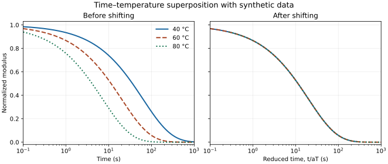

[← Portfolio home](../../README.md)

# Digital Rheometer for Dynamic Polymer Networks

*MSE 459 team project · Northwestern University · 2026*

**Team.** Mulin Zou, Kaibo Xu, and Ruizhi Jia.

Our team studied whether a surrogate model could predict stress-relaxation curves across temperatures and crosslinker molecular weights. We compared random forests, gradient-boosted trees, and a multilayer perceptron using leave-one-group-out validation. The perceptron produced smooth relaxation curves suitable for the shifting analysis.

## My contribution

I worked on feature design, result analysis, and application of the trained model. I analyzed the horizontal and vertical shift factors used to build master curves and examined how apparent activation energy and half-relaxation time varied with crosslinker molecular weight. The surrogate suggested an apparent minimum in activation energy. I am interested in testing whether that trend persists with more measurements and whether a target relaxation response can help constrain the choice of formulation.

## Time–temperature superposition example



*Synthetic demonstration. At left, the relaxation time varies with temperature. At right, plotting against reduced time t/aT collapses the curves by construction. This example uses prescribed horizontal shifts and a common modulus scale.*

[synthetic_tts.py](examples/synthetic_tts.py) generates the figure from an analytic relaxation function. It uses no project data or trained model. The example requires NumPy and Matplotlib.

From the repository root, run:

```bash
python3 projects/digital-rheometer/examples/synthetic_tts.py synthetic-master-curve.svg
```
