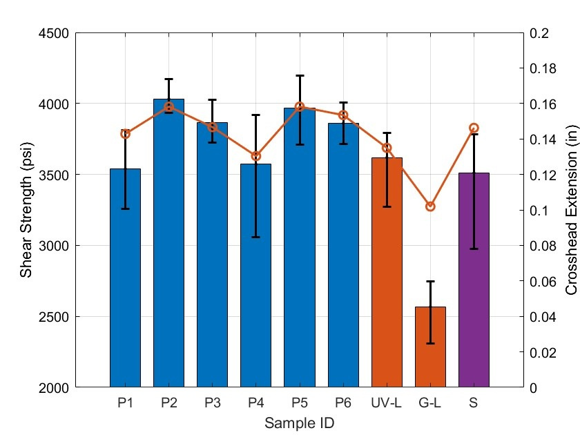

[← Portfolio home](../../README.md)

# Surface Treatment and Failure of Bonded CFRP Joints

*Senior design team project · The Ohio State University · 2024*

**Team.** Lana Al-Tamim, Kaibo Xu, and Harsh Gaur. Advised by Peter Anderson and sponsored by Honda Aircraft Company.

We evaluated atmospheric-pressure plasma and laser surface preparation for adhesively bonded carbon fiber-reinforced polymer joints. I helped prepare bonded specimens, perform single-lap shear tests, and examine fracture surfaces using optical microscopy.

## Results from the public poster

*Figure 2 from the public poster. Bars show lap shear strength and the line shows crosshead extension. P1–P6 are plasma conditions, UV-L and G-L are the ultraviolet and green laser treatments, and S is the sanded condition.*

The highest mean lap shear strength among the tested conditions came from plasma treatment at a nozzle distance of 6 mm and a nozzle speed of 150 mm/s (P2). In the representative fracture images on the poster, the plasma-treated sample showed light fiber tear and the sanded sample showed fiber tear. The microscopy helped identify where the joints failed alongside the strength measurements.

**Poster.** *Atmospheric Plasma and Laser Treatment to Maximize Polymer Composite Bond Strength*, The Ohio State University.
