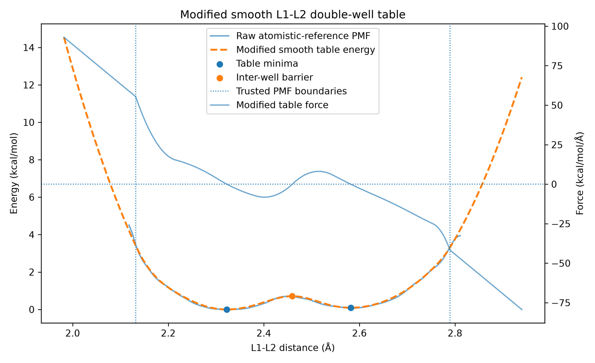
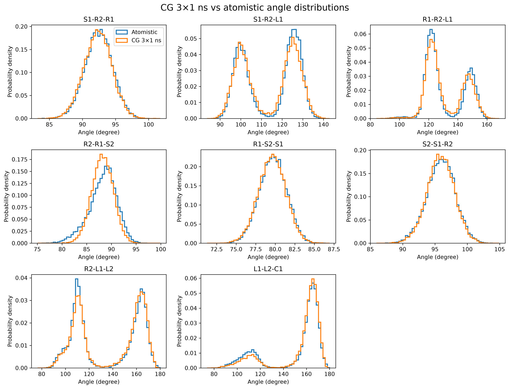

[← Portfolio home](../../README.md)

# Modeling Dynamic Poly(TA) Networks

*Master's thesis in progress · Northwestern University · Shull Group*

I am building a molecular simulation model to study how reversible disulfide exchange affects poly(thioctic acid) structure and relaxation. A longer-term question is how iron(III) coordination affects the stability and dynamics of the network.

## Coarse-graining and validation

I mapped atomistic configurations of cyclic thioctic acid to a seven-bead model, derived initial bonded potentials from the mapped distributions, and tested the assembled model in LAMMPS. I used harmonic terms for suitable single-well coordinates and tabulated potentials where the reference distributions showed multiple conformational states.

One side-chain distance, L1–L2, sampled two preferred states. Direct numerical differentiation of the sampled profile introduced artificial force spikes. I smoothed the energy curve before differentiating it and checked that the resulting coarse-grained model could still sample both states.



*L1–L2 fit for the cyclic monomer. The smoothed energy curve retains two minima, and the tabulated force follows the negative derivative of the smoothed energy.*



*Angle distributions from the mapped atomistic reference and three 1 ns coarse-grained simulations. Several angles retain both conformational populations. For L1–L2–C1, the coarse-grained model underestimates the lower-angle population.*

## Code example

[double_well_table.py](examples/double_well_table.py) samples an illustrative double-well potential and exports distance, energy, and force to CSV. It uses invented parameters and demonstrates the energy–force relationship without the thesis force field or simulation inputs.

From the repository root, run:

```bash
python3 projects/polyta-thesis/examples/double_well_table.py > double-well-demo.csv
```

## Current direction

I am extending the model to ring-opened chains and developing an MD–kinetic Monte Carlo workflow that can change disulfide connectivity. The figures here show validation of the bonded cyclic monomer model.
