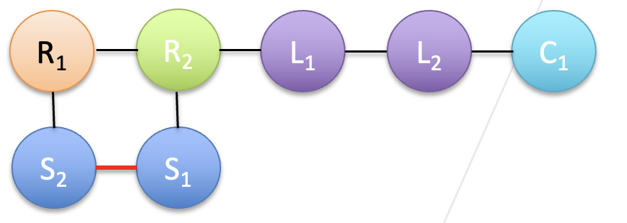

[← Poly(TA) project](../README.md)

# 0. Material system and research questions

## From thioctic acid to poly(TA)

Thioctic acid (TA), also called α-lipoic acid, contains a five-membered ring with a disulfide bond and a side chain ending in a carboxylic acid group. Ring-opening polymerization connects TA units through intermolecular S–S bonds to form poly(TA). Its carboxyl groups remain available for interactions between chains. These two parts of the molecule provide different ways to change the material’s structure and dynamics. [Zhang et al., Science Advances, 2018](https://doi.org/10.1126/sciadv.aat8192)

*Coarse-grained representation used in this project. S1 and S2 retain the sulfur sites, and C1 represents the terminal carboxyl group. The red S1–S2 bond closes the monomer ring. The following pages explain how this mapping is parameterized.*

## Dynamic backbone and interactions between chains

| Molecular feature | Role in the material |
| --- | --- |
| Reversible S–S chemistry | Ring opening, ring closure, and disulfide exchange change covalent connectivity and the populations of chains and rings. |
| Carboxylic acid groups | Hydrogen bonding can associate different poly(TA) chains into a supramolecular network. |
| Fe(III)–carboxylate coordination | Metal coordination adds associations between carboxyl-containing chains and can change cohesion and mechanical response. |

Experimental poly(TA)-based materials combine disulfide chemistry, hydrogen bonding, and metal coordination to obtain stretchability, self-healing, and adhesion. Reversible polymerization also motivates chemical recycling, with depolymerization demonstrated under suitable solution conditions. These observations motivate the molecular comparisons in my thesis. [Zhang et al., Science Advances, 2018](https://doi.org/10.1126/sciadv.aat8192) · [Zhang et al., Matter, 2021](https://doi.org/10.1016/j.matt.2021.01.014)

## What this thesis asks

My central question is how changes in covalent connectivity and transient interchain associations affect the lifetime of a load-bearing structure.

1. **Ring–chain redistribution.** How do ring opening and closure change the populations of cyclic species and linear chains, their sizes, and their packing?
2. **Connectivity rearrangement.** How does S–S exchange change which segments belong to the same molecule, and how does that affect chain motion and stress relaxation?
3. **Fe(III) stabilization.** How does adding coordination between carboxylate sites change structural persistence and the balance between relaxation and mechanical stability?

These processes may act on different timescales. A material can retain contacts between the same chains while the individual contacting sites change. Covalent exchange can also redistribute chains and rings during deformation. I therefore compare molecular connectivity, contact persistence, chain relaxation, and stress response.

## How the model connects to the material

The seven-bead model retains the sulfur sites and carboxyl-containing side chain. Bonded and nonbonded potentials describe molecular geometry and effective packing interactions. In the neat-poly(TA) baseline, hydrogen-bond effects are represented through effective nonbonded interactions. MD samples conformations and motion, while the MD–KMC framework introduces discrete changes in S–S connectivity. A Fe(III)-containing comparison then tests the contribution of coordination to the same structural and mechanical observables.

[Continue to 1. Closed-ring monomer →](01-closed-ring-monomer.md)
