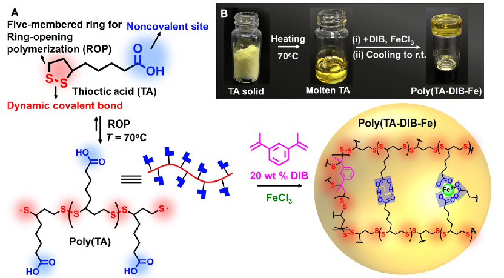

[← Poly(TA) project](../README.md)

# 0. Material system and research questions

## From thioctic acid to poly(TA)

Thioctic acid (TA), also called α-lipoic acid, contains a five-membered ring with a disulfide bond and a side chain ending in a carboxylic acid group. Ring-opening polymerization connects TA units through intermolecular S–S bonds to form poly(TA). Its carboxyl groups remain available for interactions between chains. These two parts of the molecule provide different ways to change the material’s structure and dynamics. [Zhang et al., Science Advances, 2018](https://doi.org/10.1126/sciadv.aat8192)

*Figure 1A–B (excerpt) from Zhang et al., Science Advances 4, eaat8192 (2018). The illustration shows the TA molecule, ring-opening polymerization, and hydrogen bonding and Fe(III) coordination in the experimental poly(TA-DIB-Fe) network. The published formulation contains 20 wt% DIB. In this thesis, the material comparison focuses on neat poly(TA) and a Fe(III)-coordinated system.*

*© 2018 The Authors, licensed under [CC BY-NC 4.0](https://creativecommons.org/licenses/by-nc/4.0/). [Original article](https://doi.org/10.1126/sciadv.aat8192) · [Image copy](https://mappingignorance.org/app/uploads/2018/09/Figure-1.png).*

## Dynamic backbone and interactions between chains

| Molecular feature | Role in the material |
| --- | --- |
| Reversible S–S chemistry | Ring opening, ring closure, and disulfide exchange change covalent connectivity and the populations of chains and rings. |
| Carboxylic acid groups | Hydrogen bonding can associate different poly(TA) chains into a supramolecular network. |
| Fe(III)–carboxylate coordination | Metal coordination adds associations between carboxyl-containing chains and can change cohesion and mechanical response. |

Experimental poly(TA)-based materials combine disulfide chemistry, hydrogen bonding, and metal coordination to obtain stretchability, self-healing, and adhesion. Reversible polymerization also motivates chemical recycling, with depolymerization demonstrated under suitable solution conditions. These observations motivate the molecular comparisons in my thesis. [Zhang et al., Science Advances, 2018](https://doi.org/10.1126/sciadv.aat8192) · [Zhang et al., Matter, 2021](https://doi.org/10.1016/j.matt.2021.01.014)

## What this thesis asks

My central question is how changes in covalent connectivity and transient interchain associations affect the lifetime of a load-bearing structure.

1. **Ring–chain redistribution.** How do ring opening and closure change the populations of cyclic species and linear chains, their sizes, and their packing?
2. **Connectivity rearrangement.** How does S–S exchange change which segments belong to the same molecule, and how does that affect chain motion and stress relaxation?
3. **Fe(III) stabilization.** How does adding coordination between carboxylate sites change structural persistence and the balance between relaxation and mechanical stability?

These processes may act on different timescales. A material can retain contacts between the same chains while the individual contacting sites change. Covalent exchange can also redistribute chains and rings during deformation. I therefore compare molecular connectivity, contact persistence, chain relaxation, and stress response.

## Material comparison in this thesis

I first examine how the neat poly(TA) system reorganizes through its S–S chemistry and transient interchain associations. The Fe(III)-containing comparison asks how coordination changes the persistence of those associations, the ring–chain balance, and the stress response.

[Continue to 1. Closed-ring monomer →](01-closed-ring-monomer.md)
