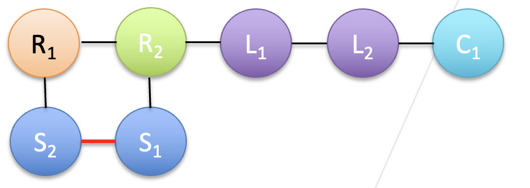
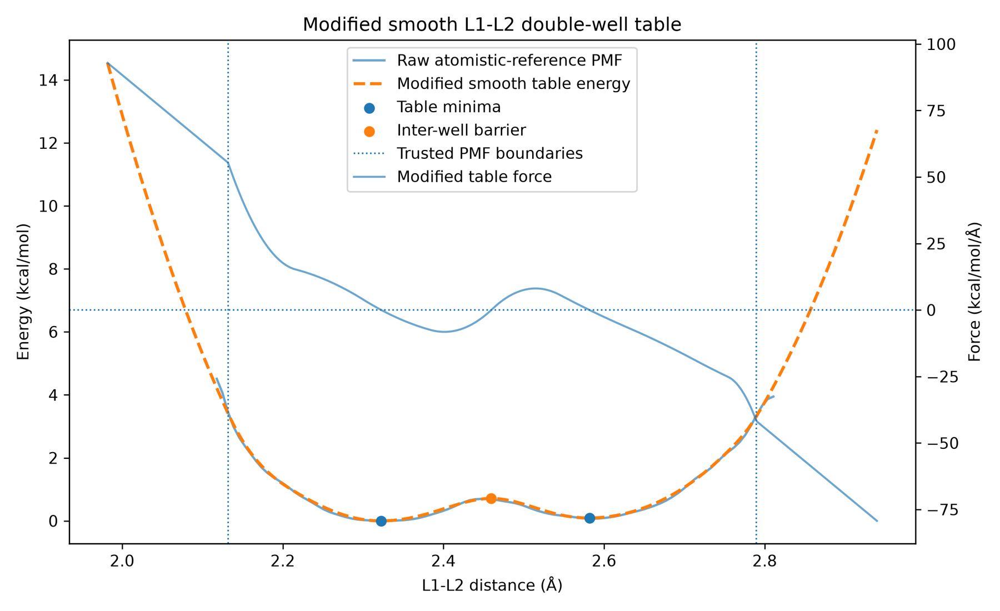
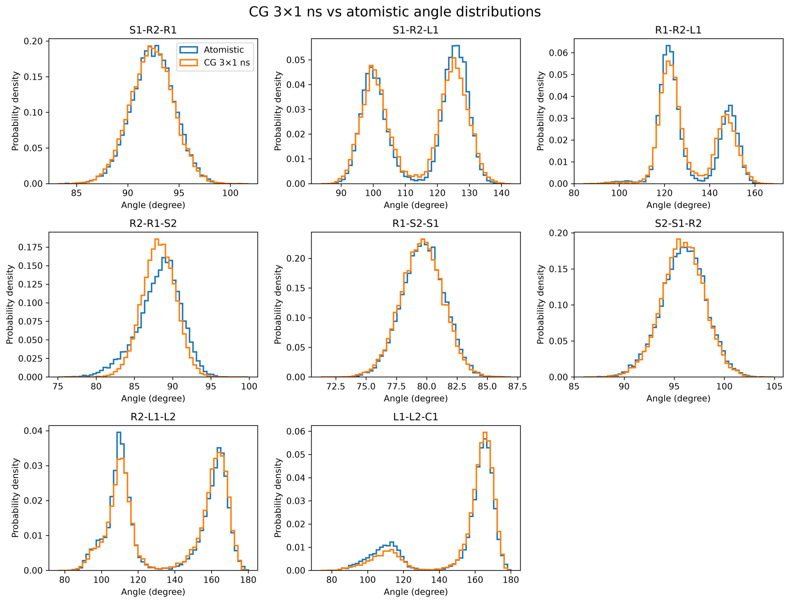

[← Poly(TA) project](../README.md)

# 1. Closed-ring monomer

## Atomistic preparation and bead mapping

I prepared neutral R-α-lipoic acid with explicit hydrogens and optimized its geometry with RDKit and MMFF94. I mapped atom groups to bead centers of mass. The initial six-bead mapping put all four side-chain methylene groups into a single bead. Even the low-energy conformers showed broad, multimodal distances around that bead. Splitting it into **L1** and **L2**, each representing two methylene groups, introduced an internal degree of freedom for side-chain bending and rotation.

*The seven-bead mapping retains both sulfur sites (S1 and S2), two other ring beads (R1 and R2), the two side-chain beads (L1 and L2), and the terminal carboxyl bead (C1). The red S1–S2 bond closes the ring.*

## Bonded force field

I used a 100 ps atomistic pilot to check structural stability and three independent 1 ns trajectories at 300 K to compare mapped geometry distributions across replicas. I used harmonic terms for suitable single-well bonds and angles, tabulated potentials for multimodal coordinates, and a periodic table for the side-chain torsion.

L1–L2 was a useful test of the tabulation. Directly differentiating the sampled energy profile produced sharp force features. I smoothed the profile before differentiating it, retaining both minima and a consistent energy–force relationship. The [double-well Python example](../examples/double_well_table.py) illustrates that relationship with an analytic model.

*The modified table retains two energy minima near 2.32 and 2.59 Å.*

## Validation at 300 K

I assembled the complete bonded model in LAMMPS, initialized it with mapped atomistic coordinates, and used minimization and finite-temperature CG trajectories to test the terms together. The CG angle distributions retain several of the dominant atomistic conformations. For L1–L2–C1, the lower-angle population remains underrepresented.

*Mapped atomistic distributions compared with three 1 ns CG trajectories.*

[Next: Open repeat unit and oligomer junction →](02-open-repeat-and-junction.md)
