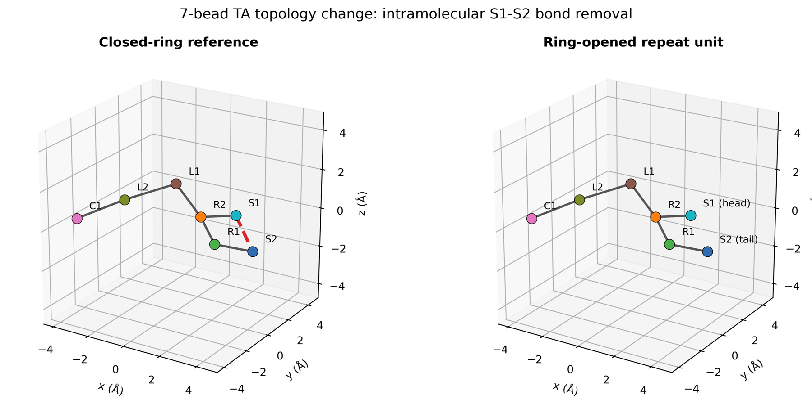
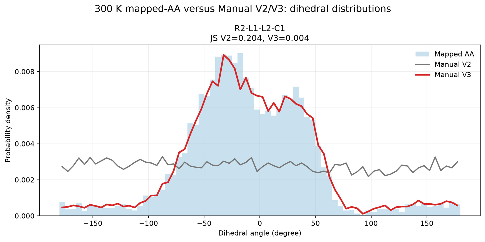
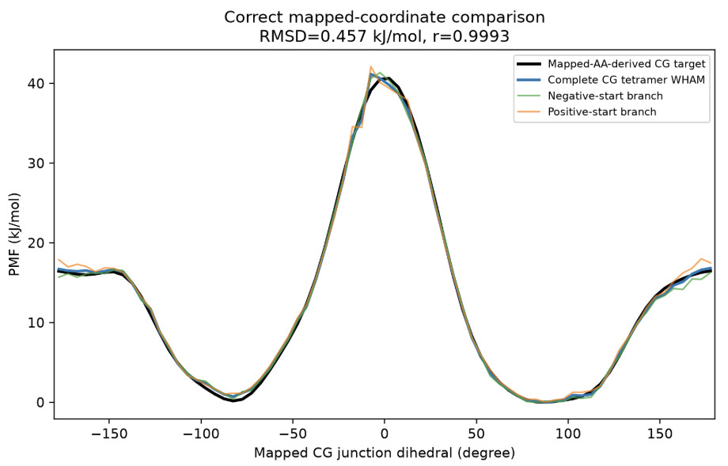
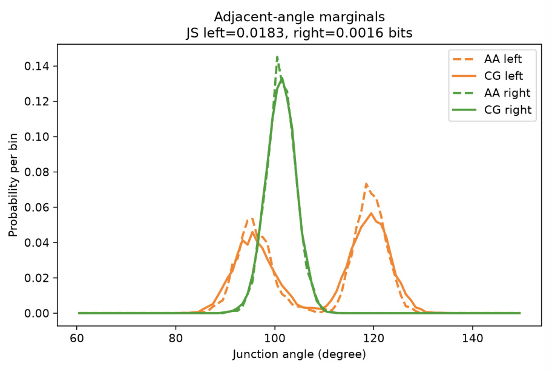

[← Poly(TA) project](../README.md)

# 2. Open repeat unit and oligomer junction

Ring opening changes the topology used to fit the force field. I parameterized the geometry **within** an opened TA unit separately from the geometry **across** the disulfide junction between two units.

*Ring opening removes the intramolecular S1–S2 bond. Inter-unit S2–S1 bonds then connect repeat units into an oligomer.*

## Within the repeat unit

I built a hydrogen-capped, disulfide-linked atomistic trimer and mapped its central unit to seven beads to reduce terminal effects. The inter-unit S–S bonds stayed near 2.15 Å at 300 K, but 10 ns atomistic extensions showed strong replica dependence in the central R2–L1–L2–C1 torsion. The pooled atomistic trajectory therefore supplied a **working fit target** with basin populations that could still depend on the starting structures.

A harmonic model provided a stable baseline. I replaced five multimodal bond and angle terms with tables and added a periodic IBI correction for the central torsion in Manual V3. The final CG validation runs used the fitted potentials without umbrella restraints or an angle wall. The earlier angle-wall pilot was run on provisional CG coordinates, so its PMF was excluded from the atomistic reference.

*The periodic correction improves agreement with the pooled mapped atomistic torsion distribution. The atomistic equilibrium basin weights remain uncertain for this repeat-unit fit.*

## Across the inter-unit S2–S1 junction

The trimer provided no junction between two fully internal units. I built an atomistic tetramer and isolated the Unit 2–Unit 3 junction. Ordinary MD left replicas in different coupled angle basins, so I used **48 periodic umbrella windows** and periodic weighted histogram analysis (WHAM) to obtain a 300 K junction potential of mean force (PMF). I mapped all 9,600 frames to CG coordinates and used their WHAM weights to obtain equilibrium targets for the junction bond, both neighboring angles, and the dihedral. The reweighting yielded an effective sample size of 3,605 frames. Bootstrap analysis supported the PMF shape, while the free-energy difference between the two basins remained unresolved.

The first CG umbrella comparison looked wrong because the LAMMPS restraint dihedral and the mapped dihedral differed by **180°**. Converting both to the same coordinate convention gave a PMF RMSD of **0.46 kJ/mol**. The junction bond and angle marginal distributions each had Jensen–Shannon (JS) divergence below **0.017 bits**.

*After converting the restraint coordinate, the complete CG tetramer closely reproduces the mapped atomistic PMF.*

## Transfer to longer oligomers

I compared trimers, tetramers, and octamers at 300 K. The octamer tests initialized different sequences of positive and negative junction conformations. Across the three chain lengths, local bond and angle distributions had JS divergences below 0.03 bits relative to the mapped reference. The largest remaining dihedral discrepancy was a modest broadening of the negative basin. The independent angle terms also produced weaker angle–angle coupling than the atomistic reference. I froze the bonded oligomer model for the nonbonded fit.

*The local angle distributions remain close to the atomistic reference after transferring the junction terms to an octamer.*

[Next: Bulk nonbonded force field →](03-nonbonded-force-field.md)
