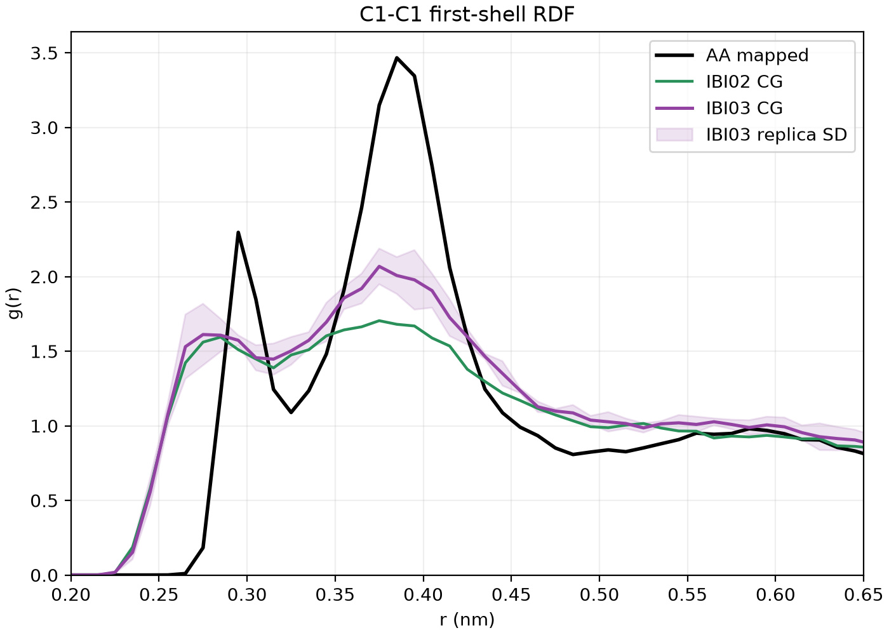
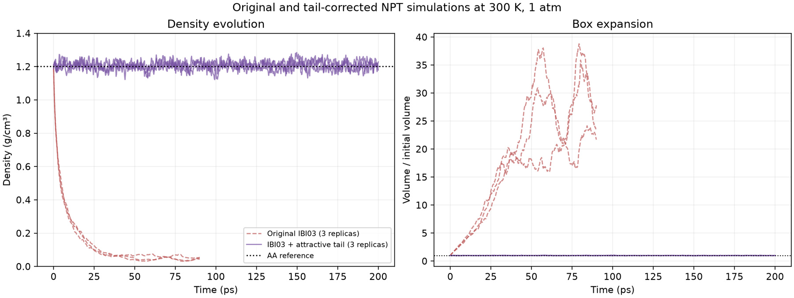
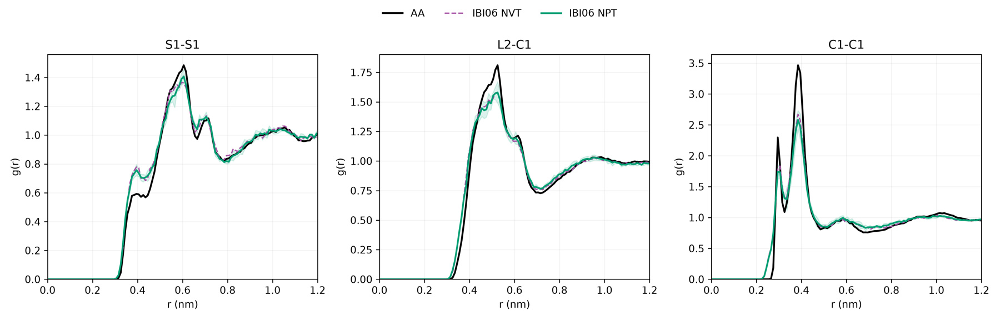

[← Poly(TA) project](../README.md)

# 3. Bulk nonbonded force field

## Fit target and WCA baseline

I used the mapped atomistic radial distribution functions (RDFs) for all **28 distinct bead pairs** as the structural targets. The reference density was **1.201 g/cm³**. The main carboxyl C1–C1 RDF peak was at **0.385 nm**, with a height of about **3.47**.

I held the bonded model fixed and started with pair-specific Weeks–Chandler–Andersen (WCA) repulsions. I iteratively updated the pair potentials using a damped correction proportional to `RT ln[g_CG(r) / g_AA(r)]`. After smoothing and tapering each correction, I generated the corresponding tabulated forces from the energy derivatives.

| NVT fit | Mean RDF RMSE |
| --- | ---: |
| WCA baseline | 0.1546 |
| WCA + IBI01 | 0.1303 |
| WCA + IBI02 | 0.1156 |
| WCA + IBI03 | 0.1029 |

*IBI03 improves the C1–C1 peak relative to IBI02, but the peak remains broader and lower than the atomistic target.*

## Test at constant pressure

The initial IBI03 model improved RDFs at fixed volume. When I released the volume at **300 K and 1 atm**, the system expanded and its density fell to approximately **0.04–0.06 g/cm³**. I added a smooth attractive tail and tuned its strength using pressure tests at the reference density. The selected tail amplitude was **0.0363 kcal/mol**. With that tail, the three NPT replicas averaged **1.208 g/cm³**.

*The original IBI03 box expands under NPT. The tail-corrected model maintains a condensed bulk phase near the atomistic reference density.*

## Compare with a Lennard–Jones baseline

I separately applied IBI starting from a Lennard–Jones (LJ) potential. The LJ-based model gave better structural agreement by mean RDF error, while the tail-corrected WCA model gave closer agreement in bulk density.

| Calibration system at 300 K and 1 atm | Mean RDF RMSE | Density (g/cm³) |
| --- | ---: | ---: |
| Mapped atomistic reference | — | 1.201 |
| WCA + IBI03 + attractive tail | 0.1080 | 1.208 |
| LJ + IBI06 | 0.0566 | 1.183 |

*LJ + IBI06 reproduces the main C1–C1 peak position, while its height is still below the mapped atomistic peak.*

The linear-chain simulations used **WCA + IBI03 + attractive tail**. The LJ branch provides a comparison for future work on how the choice of pair potential affects structure and density.

[Next: Linear chains and bulk relaxation →](04-linear-chains-and-bulk.md)
