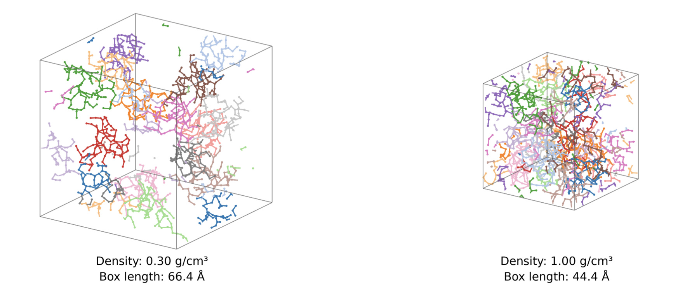
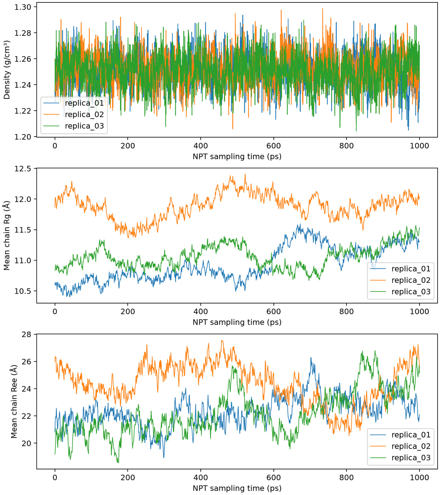
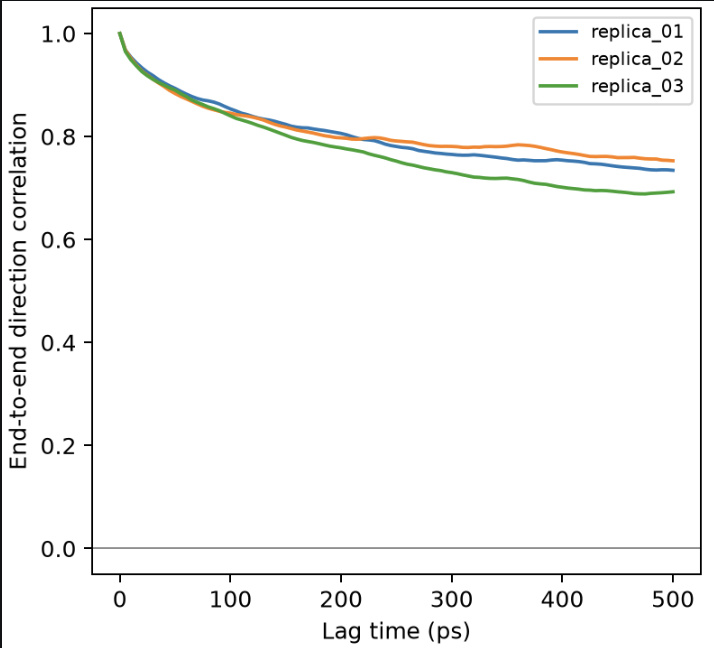

[← Poly(TA) project](../README.md)

# 4. Linear chains and bulk relaxation

## Chain construction and packing

I extended the validated tetramer topology to **16 repeat units per chain**, preserving the seven-bead mapping and generating all inter-unit bonds, angles, and dihedrals. Short single-chain simulations checked connectivity and structural stability before bulk packing.

I built three independently packed replicas, each containing **16 chains × 16 repeat units** (1,792 CG beads). I sampled conformations from the single-chain trajectory, applied random rotations and translations, screened close interchain contacts, and minimized the packed structures. The replicas were then heated to 300 K, compressed gradually, and relaxed under NPT at 1 atm.

*Example of a low-density packed configuration and an intermediate compressed configuration. The 1.00 g/cm³ snapshot precedes final NPT equilibration.*

## Density and chain-scale relaxation

After initial equilibration, I extended each replica by another **1 ns** in NPT. The mean density was approximately **1.251 g/cm³** and changed by less than **0.13%** between trajectory halves. The chain dimensions continued to evolve, although replica averages moved closer during the extension. All 16 chains remained separate, with intact inter-unit connectivity.

*Bulk density settles faster than the chain dimensions. The density plateau alone cannot establish conformational convergence.*

*End-to-end orientation correlation stays near 0.7 at 500 ps, indicating persistent memory of the initial chain orientations.*

[Next: Transient contacts and mechanical baseline →](05-contacts-and-mechanical-baseline.md)
