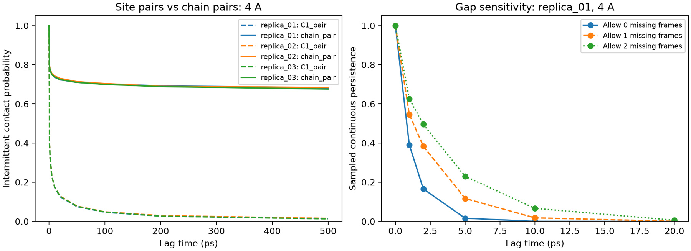
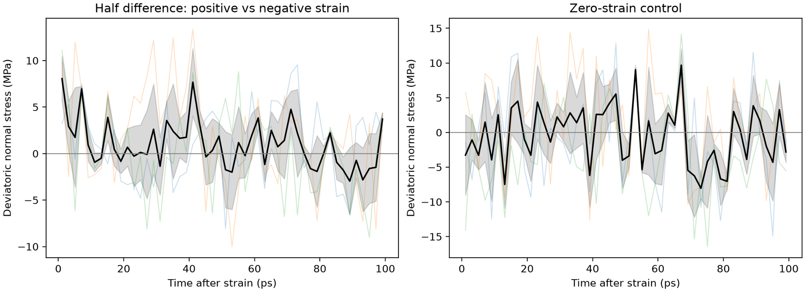

[← Poly(TA) project](../README.md)

# 5. Transient contacts and mechanical baseline

The linear-chain bulk provides a fixed-covalent-topology baseline for studying transient associations and stress relaxation before introducing reactive disulfide events.

## Site contacts and chain-pair connectivity

I counted an interchain C1–C1 contact when the sites were within **4 Å**. Continuous persistence requires the same contact to survive without interruption. Intermittent persistence also counts cases in which a pair separates and later meets again.

Individual C1 contacts turned over quickly. At the chain level, roughly **72–73 of 120** possible chain pairs shared at least one C1 contact. The chain-level associations persisted longer than individual site contacts because a chain pair can remain associated while the specific contacts between its sites change. These are proximity-based measures of association.

*Left: intermittent persistence for individual C1 site pairs and chain pairs. Right: effect of allowing short gaps in the continuous contact criterion.*

## Small-strain stress relaxation

I applied volume-preserving step strains with positive, negative, and zero-strain branches. I compared the signed response using half the difference between the positive and negative branches and used the zero-strain branch to estimate the background fluctuations.

*The initial restoring response decays rapidly. At 80–100 ps, the residual stress was within the fluctuations resolved by the controls.*

This gives a mechanical baseline for testing whether reactive disulfide topology or Fe(III) coordination changes the lifetime of the stress response.

[Next: Reactive-network comparison →](06-reactive-network-roadmap.md)
